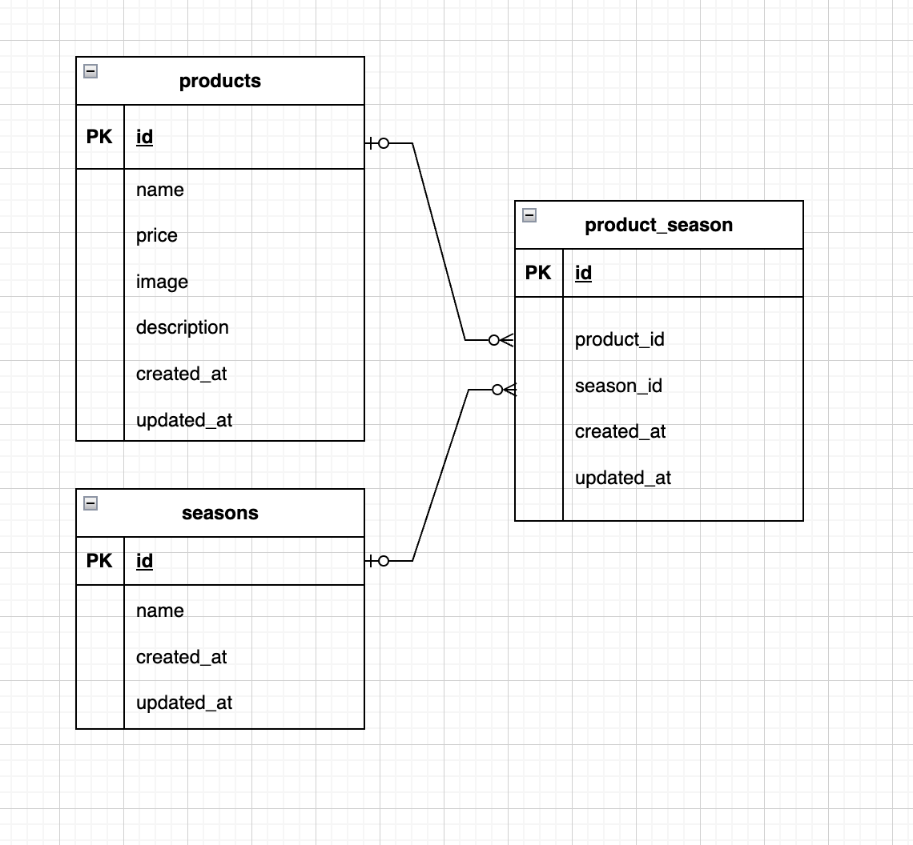

# test-mogi


# 環境構築手順（Docker + Laravel）

このリポジトリは、Docker と Laravel 環境で動作するアプリケーションです。  
以下の手順でセットアップしてください。

---

## 1. リポジトリのクローン

```bash
git clone git@github.com:ando625/test-mogitate.git
cd test-mogitate
```


---

## 2. Docker コンテナの起動

Docker Desktop を起動して、以下を実行します：

```docker compose up -d --build```


## 3. Laravel 環境構築

### 3-1. PHP コンテナに入る

```docker compose exec php bash```

### 3-2. Composer で依存関係をインストール

```composer install```

### 3-3. .env ファイル作成

```cp .env.example .env```

.env に以下の環境変数を設定します：

```DB_CONNECTION=mysql
DB_HOST=mysql
DB_PORT=3306
DB_DATABASE=laravel_db
DB_USERNAME=laravel_user
DB_PASSWORD=laravel_pass
```

### 3-4. アプリケーションキー生成

```php artisan key:generate```

### 3-5. データベース準備

- マイグレーション実行
```php artisan migrate```

- シーディング実行
```php artisan db:seed```

### 3-6. ストレージのリンク作成

画像をブラウザで表示するために、storage ディレクトリをリンクします：

```php artisan storage:link```


---

## 5. 注意事項

- Docker の MySQL データは Git には含めないよう .gitignore に設定済みです。  
- Mac M1/M2 でビルドエラーが出た場合は、platform: linux/x86_64 を追加してください。
- PHP 8.1 以降、`mbstring.internal_encoding` は非推奨のため、`docker/php/php.ini` ではコメントアウト済みです（文字コードは `default_charset` の初期値 UTF-8 が使われます）。  
- `docker/php/php.ini` を変更したときは、イメージに焼き込まれるため `docker compose up -d --build` で作り直してください。


## 利用環境(実行環境)

- PHP: 8.4  
- Laravel: 13  
- MySQL: 8.0.26  

## バージョンアップと脆弱性チェック

### バージョンアップ（2026年11月）

PHP 8.1 + Laravel 8 から、PHP 8.4 + Laravel 13 に更新しました。  
Laravel は公式のアップグレードガイドに沿って 8 → 9 → 10 → 11 → 12 → 13 と1段ずつ上げています。

| 対象 | 変更前 | 変更後 | セキュリティ修正の期限 |
|---|---|---|---|
| PHP | 8.1 | 8.4 | 2028-12-31 |
| Laravel | 8 | 13 | 2028-03-17 |

- 期限の出典: [PHP Supported Versions](https://www.php.net/supported-versions.php) / [Laravel Release Notes](https://laravel.com/docs/13.x/releases)
- `composer audit` で検出された脆弱性は、更新前の59件から0件になりました

### 脆弱性チェックの方法

PHP コンテナの中で次のコマンドを実行すると、依存パッケージに既知の脆弱性やマルウェアがないか確認できます（マルウェアの確認には新しい Composer が必要です。2.8 では確認されず、2.11 では確認されることを確かめています）。

```bash
composer audit
```

### 自動チェック

| 仕組み | 内容 |
|---|---|
| GitHub Actions（`.github/workflows/composer-audit.yml`） | `main` への push・PR・毎週月曜に `composer audit` を実行し、問題があれば失敗にする |
| Dependabot（`.github/dependabot.yml`） | composer と Dockerfile の更新を毎週チェックし、更新があれば PR を作る |

---




URL
開発環境：http://localhost/products

phpMyAdmin:：http://localhost:8080/